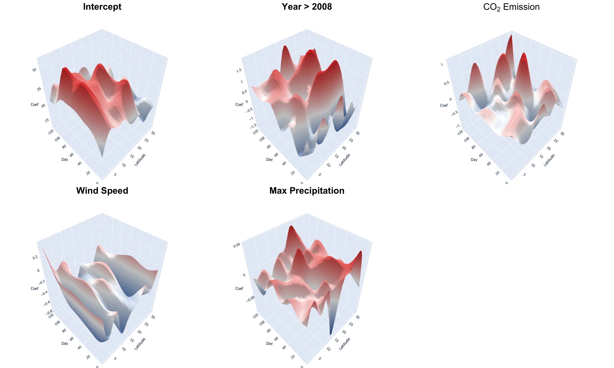
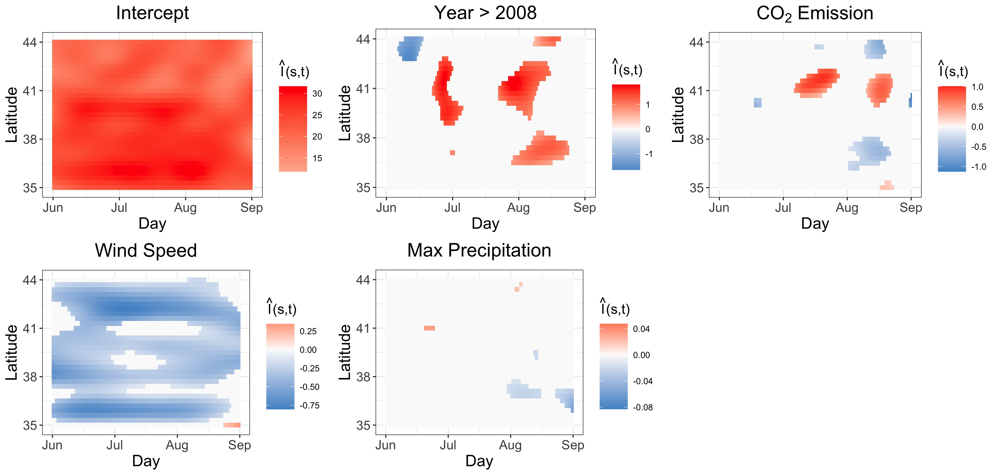
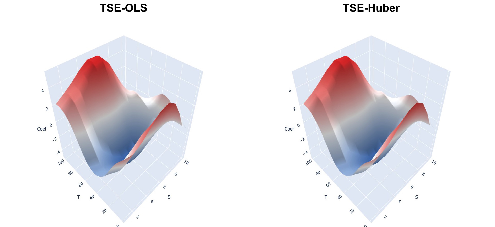
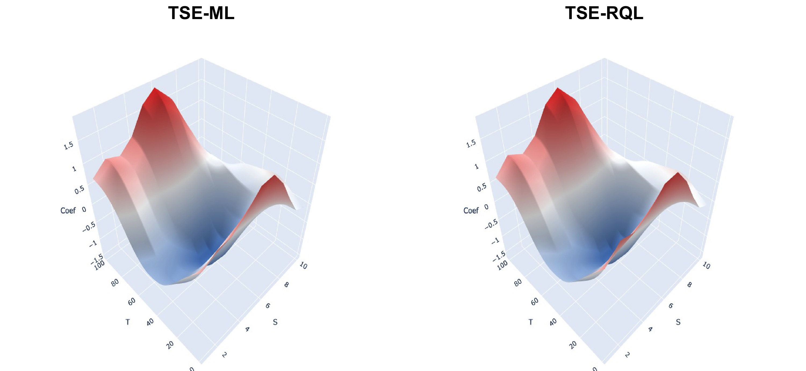

# Statistical Inference for Generalized Two-Dimensional Functional Mixed Effects Models

## Description

Repeatedly measured functional data arise when a curve is recorded on a dense grid at each of a series of visits, as with minute-level physical activity across days of the week, or daily temperature across latitudes. Most existing functional mixed models target continuous responses. Discrete curves, such as an active-versus-sedentary indicator, are common in wearable-device studies and need a generalized model.

This repository implements a generalized two-dimensional functional mixed model (2dGFMM) for Gaussian and dichotomous functional responses. Bivariate coefficient functions are estimated by a two-stage M-estimator: a pointwise regression at each grid point, followed by a bivariate smoother. Subject-level bootstrap then builds pointwise confidence bands, simultaneous confidence bands, and a test of \(H_0:\beta(s,t)=0\). The two families have separate entry points. For Gaussian responses `gfmm2d_gaussian()` uses ordinary least squares (TSE-OLS) or Huber regression (TSE-Huber). For dichotomous responses `gfmm2d_binomial()` uses a logistic-normal integral link, with maximum likelihood (TSE-ML) or robust quasi-likelihood (TSE-RQL).

Install the R packages once if they are missing:

```r
install.packages(c(
  "dplyr", "mgcv", "refund", "fdapace", "Matrix", "mvtnorm",
  "MASS", "robustbase", "zoo", "ggplot2", "ggpubr", "lme4", "jpeg"
))
```

`lme4` is only needed for the dichotomous estimator, which estimates the latent variance by a local random-intercept model.

The three-dimensional surfaces also need `python3` with `plotly` and `kaleido` (`pip install plotly kaleido`). The `jpeg` package reads the generated JPEG panels, so no system image tool is required. Building the temperature data additionally needs `fda.usc`, `climaemet` and `lubridate`; see [`data/README.md`](data/README.md). Run the demos from this directory.

## Estimators

```
gfmm2d_gaussian(formula, data, S, robust = TRUE,
                smoother = "sandwich", knots = NULL, analytic = FALSE,
                bootstrap.opt = list(B = 50, M = 10000, method = "nonparametric"),
                bandwidth.control = list(d = 2, adjust = NULL, correct = 1),
                pcb = TRUE, scb = FALSE, parallel = FALSE, silence = FALSE)

gfmm2d_binomial(formula, data, S, robust = FALSE,
                smoother = "sandwich", knots = NULL, eta.var = NULL,
                variance.control = list(window = c(1, 3), hs = NULL, ht = NULL, nAGQ = 7L),
                bootstrap.opt = list(B = 50, M = 10000, method = "nonparametric"),
                bandwidth.control = list(d = 2, adjust = NULL),
                gh.n = 40L, robust.c = 1.345, robust.wx = "none",
                pcb = TRUE, scb = FALSE, parallel = FALSE, silence = FALSE,
                keep_diagnostics = TRUE)
```

### Arguments

* `formula`: a two-sided formula. The response is a matrix, one row per visit.
* `data`: a data frame with an `ID` column, the covariates, and the response matrix.
* `S`: number of visits, the longitudinal grid.
* `robust`: `FALSE` uses OLS or maximum likelihood; `TRUE` uses Huber loss or robust quasi-likelihood.
* `smoother`: `"sandwich"` or tensor-product `"te"`.
* `knots`: `c(Sknots, Tknots)`.
* `bootstrap.opt`: `B` is the number of subject-level bootstrap replicates; `M` is the number of draws used for simultaneous bands; `method` must be `"nonparametric"`.
* `pcb`, `scb`: estimate pointwise and simultaneous bands.
* `parallel`: `TRUE` only on Linux or Mac.
* `silence`: suppress the step log.
* `analytic` (Gaussian only): analytic covariance instead of the bootstrap; much faster and available only in `gfmm2d_gaussian()`.
* `eta.var` (dichotomous only): the latent variance surface \(v(s,t)\). If `NULL`, it is estimated once from a local random-intercept model controlled by `variance.control`; supplying a scalar or an \(S \times T\) matrix skips that step. `lme4` is needed only when it is estimated.
* `variance.control` (dichotomous only): `window = c(hs, ht)` sets the local window on the visit and time axes; `hs`/`ht` override the two half-widths; `nAGQ` sets the adaptive Gauss-Hermite nodes of `glmer`.
* `gh.n`, `robust.c`, `robust.wx` (dichotomous only): Gauss-Hermite nodes for the integral link, the Huber tuning constant, and the leverage weighting (`"none"` or `"covMcd"`).

### Values

* `betaHat`: list of estimated bivariate coefficient surfaces.
* `betaHat.cov`: covariance array of those surfaces.
* `qn`: simultaneous-band multiplier. It is zero when only pointwise bands are requested.
* `vm`: bootstrap draws used by `pvalues.gfmm2d()`.
* `eta.var` (dichotomous only): the variance surface used, with diagnostics in `variance_diagnostics` and `variance_summary`.

## `pvalues.gfmm2d`

`pvalues.gfmm2d()` tests

$$H_0:\beta_p(s,t)=c\quad\text{for every }(s,t),$$

one coefficient surface at a time. The fit has to be run with `scb = TRUE`. The p-value is the smallest \(\alpha\) at which the simultaneous band of level \(1-\alpha\) excludes the constant surface \(c\). A binary search reads that \(\alpha\) from the Monte Carlo draws stored in `fit$vm`.

```r
fit <- gfmm2d_gaussian(
  formula = Y ~ X, data = data, S = S,
  robust = FALSE, smoother = "sandwich", knots = knots,
  bootstrap.opt = list(B = 50, M = 10000, method = "nonparametric"),
  pcb = TRUE, scb = TRUE
)
pvalues.gfmm2d(fit, const = 0, tol = 0.001, delta = 0)
```

* `const`: the constant \(c\). The default `0` tests no association.
* `tol`: width at which the binary search stops. The demos use `0.001`; the function default is `0.01`.
* `delta`: the demos pass `0`. The p-value is then the smaller of the two one-sided critical levels, so either side of the band can reject. The default `0.6` is a correction used only when those two levels are close; `sig_level` (default `0.05`) enters only in that correction.

The return value is a numeric vector in formula order: intercept, then each covariate. While it searches, the function prints `alpha_low` and `alpha_high` for that coefficient. With `tol = 0.001` the search cannot go below \(1/2048\approx 0.000488\) or above \(1-1/2048\approx 0.999512\). A reported `0.000488` means the band excludes \(c\) at every level the search can resolve.

## Spanish Summer Temperature

Daily temperature from the Spanish Meteorological Agency, summers 2003–2023, is regressed on a post-2008 year indicator, CO\(_2\) emissions, wind speed, and maximum precipitation. Latitude is the longitudinal index and day within June–September is the functional index. Stations are restricted to altitudes 30–650 m and longitudes at or east of \(-13\).

The demo reads `data/aemet_dat.RData`, which is **not shipped** with the repository. Build it once from AEMET OpenData (a free API key is needed only for this step):

```bash
Rscript data/prepare_aemet.R
```

The script downloads the daily records of 73 stations, aligns each year to a 365-day calendar, and saves the 66 stations with usable records. See [`data/README.md`](data/README.md) for the API-key setup, the exact processing rules, and the structure of the resulting table.

Then run the demo:

```bash
Rscript demo_aemet.R
```

The fit is Gaussian TSE-OLS with the tensor-product smoother, \(B=50\), and \(M=10000\).

### Estimation

<p float="left">
  
</p>

Marginal slices are saved as `output/aemet/temp_altitude_ols_day.jpeg` and `output/aemet/temp_altitude_ols_altitude.jpeg`. The fitted object is `output/aemet/temp_altitude_ols.RData`.

### Hypothesis testing

The test of \(H_0:\beta(s,t)=0\), in the order intercept, year after 2008, CO\(_2\), wind, maximum precipitation, returns

```
0.000488  0.005371  0.000488  0.000488  0.022949
```

All five reject a zero surface at level \(0.05\). The intercept is a summer temperature, so its band lies above zero and the p-value is the search floor. Maximum precipitation is the weakest of the five: part of that surface is negative enough for the band to exclude zero at \(\alpha=0.023\). The heat map below marks the grid points where the simultaneous band excludes zero, colored by the sign of the estimate.

<p float="left">
  
</p>

## Synthetic Example

One Gaussian sample and one dichotomous sample are drawn with seed `123`, \(n=50\), \(S=10\), and \(T=100\):

$$g\{E[Y_i(s,t)\mid X_i]\}=\beta_0(s,t)+X_i(s)\beta_1(s,t)+\eta_i(s,t),\qquad s,t\in[0,1].$$

The link \(g\) is the identity for a Gaussian response and the logit for a dichotomous response. Dichotomous coefficient surfaces are multiplied by \(0.25\) before the responses are drawn. Both samples use \(\mathrm{SNR}_B=\mathrm{SNR}_\epsilon=1\), bootstrap \(B=50\), and \(M=10000\).

```bash
Rscript demo_synthetic.R
```

Three-dimensional estimates of the Gaussian slope:

<p float="left">
  
</p>

Three-dimensional estimates of the dichotomous slope:

<p float="left">
  
</p>

On this seed the Gaussian tests of \(H_0:\beta(s,t)=0\) return `0.000488` for both the intercept and the slope under TSE-OLS and TSE-Huber. Integrated squared error is 0.339 and 0.180 for the Gaussian intercept and slope under TSE-OLS (0.282 and 0.167 under TSE-Huber). The dichotomous fits use the logistic-normal integral link; the demo prints their integrated squared error, coverage, and p-values and writes them with the fits to `output/synthetic/`. The dichotomous figure below comes from an earlier conditional-logit release; rerun `demo_synthetic.R` to regenerate it with `gfmm2d_binomial()`.

## Files

* `demo_synthetic.R`: Gaussian and dichotomous synthetic examples.
* `demo_aemet.R`: Spanish summer-temperature example.
* `data/prepare_aemet.R`: downloads the AEMET daily records and builds `data/aemet_dat.RData`, the station table used by the temperature demo.
* `data/README.md`: data source, API-key setup, processing rules, and the structure of the table.
* `R/src/main.R`: loads the estimators, the utilities, and the hypothesis test.
* `R/src/gfmm2d_gaussian.R`: `gfmm2d_gaussian()` for Gaussian responses.
* `R/src/gfmm2d_binomial.R`: `gfmm2d_binomial()` for dichotomous responses (logistic-normal integral link).
* `R/src/utils.R`: FPCA, B-spline regression, and the Gaussian bootstrap wrapper.
* `R/src/hypothesis_testing.R`: `pvalues.gfmm2d()`.
* `R/helpers/sim_generate.R`: synthetic data and the true coefficient surfaces.
* `R/helpers/evaluate.R`: integrated squared error, coverage, and band width.
* `R/helpers/plot_synthetic.R`: three-dimensional synthetic surfaces.
* `R/helpers/aemet_models.R`: temperature data and `fit_temperature()`.
* `R/helpers/plot_bands.R`: bivariate and marginal confidence-band panels, and the panel assembly shared by the demos. The temperature-specific layout is in `demo_aemet.R`.
* `R/helpers/plot_surface_3d.R` and `plot_surface_3d.py`: three-dimensional coefficient surfaces.
* `.gitignore`: fitted `.RData` objects, the downloaded AEMET cache, and the built `data/aemet_dat.RData` are not tracked. The JPEG figures are kept.

## Authors

Cheng Cao†, Tianyu Yan†, Jiguo Cao, Yunting Zhang, Fan Jiang, Xinyue Li

†These authors contributed equally.
